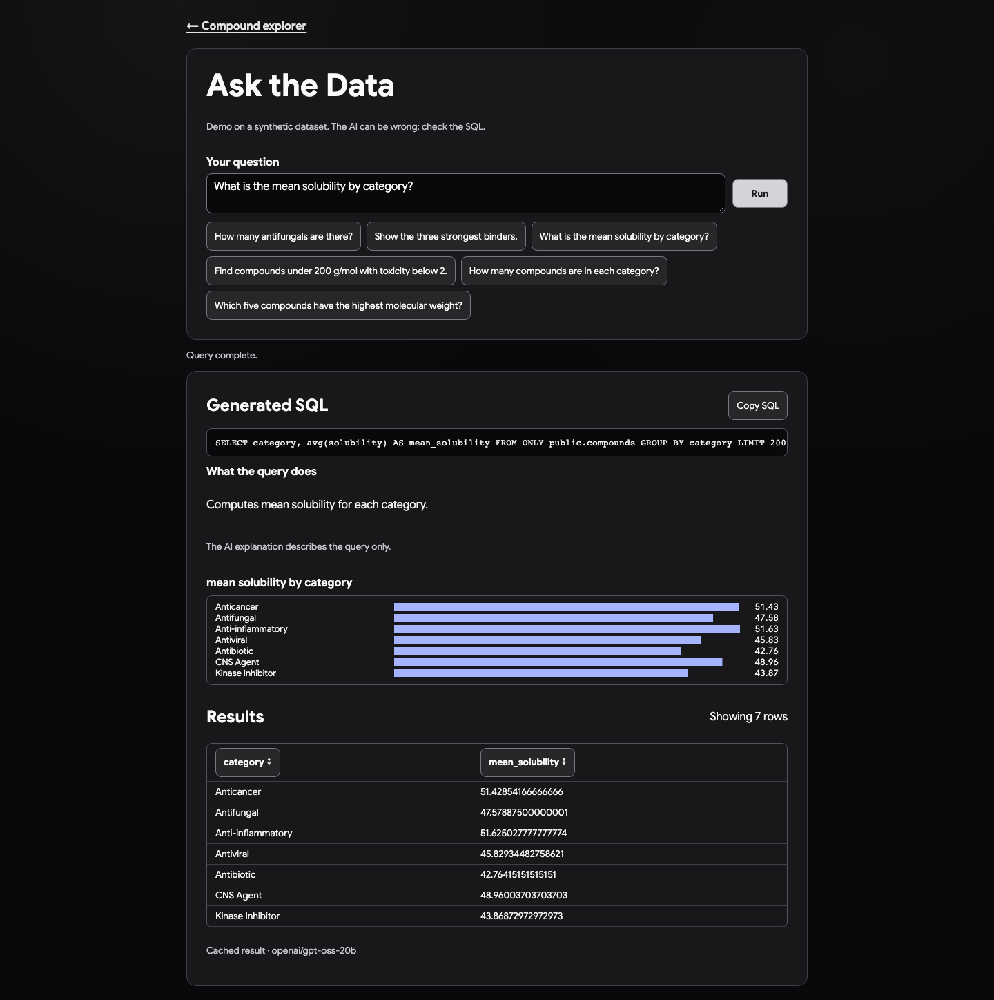
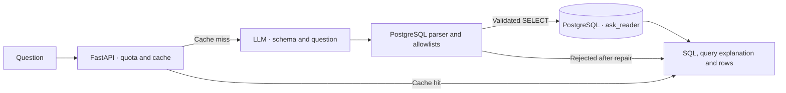
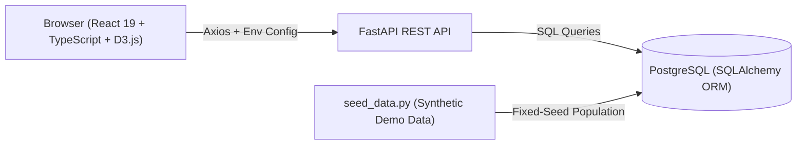

# Scientific Compound Data Explorer

Interactive full-stack dashboard for filtering, analyzing, and visualizing synthetic scientific compound libraries with React, TypeScript, D3.js, FastAPI, and PostgreSQL.


**Live Demo:** [https://scientific-dashboard-ui.vercel.app/](https://scientific-dashboard-ui.vercel.app/)  
**Live API:** [https://scientific-dashboard-api.vercel.app/](https://scientific-dashboard-api.vercel.app/)


## Overview

The Scientific Compound Data Explorer lets users filter compounds by category, molecular weight range, and ID, inspect summary KPIs, explore three responsive D3 visualizations, sort and paginate through compound records, and export filtered results to CSV.

> **Note:** The dataset is synthetic demo data generated with a fixed random seed (`seed_data.py`). It is not a real pharmaceutical or chemistry dataset.

## Ask the Data

Ask a question about the synthetic compound library and inspect the generated SQL, executed results, and query explanation.





The provider receives the question and the synthetic schema. Repair requests include a sanitized error hint. Result rows stay between PostgreSQL and the API. Each question has a shared budget of two provider calls, including retries, failover, and repair. PostgreSQL's parser handles comments and statement boundaries before an AST allowlist checks the query shape, relations, columns, and functions. It supports one SELECT, optionally with one bounded, nonrecursive CTE, and caps the response at 200 rows. A one-row probe detects truncation when the service supplies the cap. See [SECURITY.md](SECURITY.md).

### Provider configuration

The defaults are Groq `openai/gpt-oss-20b` with low reasoning, Gemini `gemini-3.5-flash-lite` with its default minimal thinking, and Cerebras `qwen-3.8-27b` with reasoning disabled. The API requests JSON object output and supplies no tools. The live evaluation used Groq. [Groq model](https://console.groq.com/docs/model/openai/gpt-oss-20b), [Gemini OpenAI compatibility](https://ai.google.dev/gemini-api/docs/openai), [Cerebras OpenAI compatibility](https://inference-docs.cerebras.ai/resources/openai)

Groq lists a free plan. Gemini publishes free-tier pricing and shows active limits per project in AI Studio. Cerebras offers trial credits with an expiry. Set the runner's per-model `LLM_*_RPM` and `LLM_*_TPM` from your account limits before starting an eval. [Groq limits](https://console.groq.com/docs/rate-limits), [Gemini limits](https://ai.google.dev/gemini-api/docs/rate-limits), [Cerebras limits](https://inference-docs.cerebras.ai/support/rate-limits)

### Run Ask the Data locally

1. Seed a fresh PostgreSQL database using the instructions below. Run `backend/ask_readonly.sql` as the database owner. Configure authentication for `ask_reader` using your PostgreSQL host's credential management.
2. Run Redis locally or supply an isolated TLS-enabled Redis instance. Set `ASK_REDIS_URL` and choose a unique `ASK_REDIS_NAMESPACE` for the environment. Redis stores shared quotas, provider cooldowns and short-lived cached results.
3. Set `ASK_DATABASE_URL` to the restricted `ask_reader` DSN and `ASK_ENABLED=true`. Set a provider key as a host secret and configure `LLM_PROVIDER_ORDER`. Use `CORS_ORIGINS` for the exact frontend origin.
4. Open the dashboard and choose **Ask the Data**, or navigate to `/#ask`. Set `ASK_ENABLED=false` to pause requests. The default caps are five per IP per UTC minute, 20 per IP per UTC day, and 100 globally per UTC day. Use `ASK_PER_IP_MINUTE`, `ASK_PER_IP_DAY`, and `ASK_GLOBAL_DAY` to configure them.

### POST /api/ask

Send JSON with a `question` string of up to 300 characters. A successful response has `status: "ok"`, `sql`, `explanation`, `columns`, `rows`, `row_count`, `truncated`, `latency_ms`, `model`, `tokens`, and `repaired`. Responses also identify the provider and model call count. The API can return `refuse` or `error` with a readable reason. Rate-limited requests return `capacity` with HTTP 429. The kill switch returns `paused` with HTTP 503.

### Tests and evaluations

```bash
python -m pip install -r backend/requirements-dev.txt -r evals/requirements.txt
(cd backend && python -m pytest)
(cd frontend && npm ci && npm test && npm run lint && npm run build)
python evals/run.py --verify-gold
python evals/run.py --budget 40
python evals/run.py --resume --budget 40
```

Set `ASK_TEST_OWNER_DSN` to a **fresh disposable PostgreSQL instance** that allows the role test to log in as owner and reader. Set `ASK_TEST_REDIS_URL` for the Redis integration test. CI runs both. The eval reads `backend/.env`, uses `ASK_DATABASE_URL`, and calls the same query service with its own rate limiter. Use a seeded synthetic database. The daily case budget survives resuming, and the journal keeps infrastructure failures and their one retry. The evaluator bypasses the web cache for independent passes.

Read the [evaluation report](evals/results/latest.md) for measured results and the frozen commit. The small, synthetic dataset and project-authored questions limit generalizability. Queries requiring joins or nested subqueries are outside the supported grammar. Quality and latency vary by provider and run.

<!-- ask-eval-results:start -->
<!-- ask-eval-results:end -->

## Architecture



## Features

- **Reactive KPI Summary**: Total compounds, active categories, average toxicity, and best binding affinity update dynamically with filters.
- **Interactive D3 Visualizations**:
  - **Molecular Weight vs Toxicity Scatter Plot**: Clickable category color legend, rich hover tooltips (ID, category, weight, toxicity, affinity), point selection, and `"Showing N of M compounds"` caption.
  - **Avg Binding Affinity Bar Chart**: Sorted descending with value labels, exact mean & compound count tooltips.
  - **Molecular Weight Distribution Histogram**: 100 g/mol buckets with compound count tooltips.
  - All charts resize via `ResizeObserver` and display clear empty states when no records match.
- **Sortable, Paginated Table**: Server/client-consistent sorting across all columns, 25 rows per page, ID search, category chips, `"Showing 1-25 of N"` indicator, and CSV export.
- **Resilient UX**: Loading skeletons, 3-second cold-start notice, friendly error banner with Retry, debounced & validated weight filters (`min <= max`), and responsive layout down to `390px`.

## Tech Stack

| Layer | Technologies |
| --- | --- |
| Frontend | React 19, TypeScript, Vite, Axios, CSS Modules |
| Visualization | D3.js v7 |
| Backend | FastAPI, SQLAlchemy, Pydantic, Uvicorn |
| Database | PostgreSQL |
| Testing | Vitest, React Testing Library, jsdom, Playwright |
| Component Docs | Storybook |
| CI | GitHub Actions |

## API Endpoints

| Method | Endpoint | Description |
| --- | --- | --- |
| `GET` | `/` | API health check |
| `GET` | `/compounds` | Paginated, filtered, sortable compound list |
| `GET` | `/compounds/stats` | Aggregate category and molecular weight distribution stats |
| `GET` | `/compounds/{compound_id}` | Single compound by numeric ID |
| `POST` | `/compounds` | Create a compound |
| `GET` | `/compounds/categories/list` | List distinct compound categories |
| `POST` | `/api/ask` | Ask a read-only question about the synthetic data |

### `/compounds` Query Parameters

- `page` (default `1`), `page_size` (default `20`, max `100`)
- `category`, `min_weight`, `max_weight`, `min_toxicity`, `max_toxicity`, `search`
- `sort_by` (`id`, `name`, `category`, `molecular_weight`, `toxicity_score`, `binding_affinity`), `sort_order` (`asc`, `desc`)

## Running Locally

### 1. Backend (FastAPI + PostgreSQL)

```bash
cd backend
python3 -m venv .venv
source .venv/bin/activate
pip install -r requirements.txt
cp .env.example .env
# Edit .env with your PostgreSQL DATABASE_URL and CORS_ORIGINS
python seed_data.py
uvicorn main:app --reload --port 8000
```

API docs are available at `http://127.0.0.1:8000/docs`.

### 2. Frontend (React + Vite)

```bash
cd frontend
npm ci
cp .env.example .env
# Set VITE_API_URL=http://localhost:8000 (or your deployed API URL)
npm run dev
```

Open `http://localhost:5173`.

## Running Tests, Lint, and Storybook

```bash
cd frontend
npm run lint
npm test
npm run build
npm run storybook
```

## Limitations

- **Synthetic Data**: All compound records, formulas, molecular weights, solubilities, toxicity scores, and binding affinities are synthetically generated in `backend/seed_data.py` using a fixed random seed (`42`) for reproducible demonstration and UI testing.
- **Sampling**: The scatter plot displays up to 100 compounds per API query (`page_size=100`) and indicates the exact count in its caption.

## License

[MIT](LICENSE)
