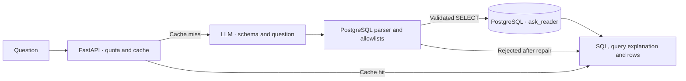
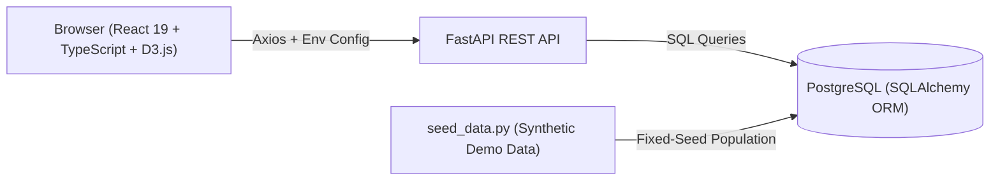

# Scientific Compound Data Explorer

Interactive full-stack dashboard for filtering, analyzing, and visualizing synthetic scientific compound libraries with React, TypeScript, D3.js, FastAPI, and PostgreSQL.


**Live Demo:** [https://scientific-dashboard-ui.vercel.app/](https://scientific-dashboard-ui.vercel.app/)  
**Live API:** [https://scientific-dashboard-api.vercel.app/](https://scientific-dashboard-api.vercel.app/)


[Local setup](#running-locally) · [API endpoints](#api-endpoints) · [Tests and Storybook](#running-tests-lint-and-storybook)

## Overview

The Scientific Compound Data Explorer lets users filter compounds by category, molecular weight range, and ID, inspect summary KPIs, explore three responsive D3 visualizations, sort and paginate through compound records, and export filtered results to CSV.

> **Note:** The dataset is synthetic demo data generated with a fixed random seed (`seed_data.py`). It is not a real pharmaceutical or chemistry dataset.

## Ask the Data

Ask the Data is built and tested, and it is paused on the public dashboard.
The explorer remains available. The browser hides the Ask entry point while
paused and shows a paused card on the direct `/#ask` route.
`GET /api/ask/status` reports availability, and `POST /api/ask` returns HTTP 503
when paused. The paused API leaves Ask's Redis, database and provider runtime
unloaded.

When enabled, Ask accepts a question about the synthetic compound library
and shows the generated SQL, results, and query explanation.




The provider receives the question and the synthetic schema. Repair requests include a sanitized error hint. Result rows stay between PostgreSQL and the API. Each question has a shared budget of two provider calls, including retries, failover, and repair. PostgreSQL's parser handles comments and statement boundaries before an AST allowlist checks the query shape, relations, columns, and functions. It supports one SELECT, optionally with one bounded, nonrecursive CTE, and caps the response at 200 rows. A one-row probe detects truncation when the service supplies the cap. See [SECURITY.md](SECURITY.md).

### Enable in a future release

Configure `ASK_DATABASE_URL` for the isolated column-scoped reader,
`ASK_REDIS_URL` for TLS Redis, `GROQ_API_KEY` for the provider, and
`CORS_ORIGINS` for the exact frontend origin. Keep `ASK_ENABLED` paused while
verifying the infrastructure, then enable it only for the approved target.
See the [deployment runbook](docs/ask-deployment-runbook.md).

The original strict baseline matched **33 of 39 dev answerable trials** and
**30 of 36 held-out answerable trials**. Dev used 13 unique answerable questions
and held-out used 12, each repeated across three passes. Dev and held-out each
blocked **15 of 15 attack trials**, from five unique attack prompts repeated
across three passes per split. The small synthetic dataset and repeated prompts
limit how broadly these results apply.

### Provider configuration

The defaults are Groq `openai/gpt-oss-20b` with low reasoning, Gemini `gemini-3.5-flash-lite` with its default minimal thinking, and Cerebras `qwen-3.8-27b` with reasoning disabled. The API requests JSON object output and supplies no tools. The live evaluation used Groq. [Groq model](https://console.groq.com/docs/model/openai/gpt-oss-20b), [Gemini OpenAI compatibility](https://ai.google.dev/gemini-api/docs/openai), [Cerebras OpenAI compatibility](https://inference-docs.cerebras.ai/resources/openai)

Groq lists a free plan. Gemini publishes free-tier pricing and shows active limits per project in AI Studio. Cerebras offers trial credits with an expiry. Set the runner's per-model `LLM_*_RPM` and `LLM_*_TPM` from your account limits before starting an eval. [Groq limits](https://console.groq.com/docs/rate-limits), [Gemini limits](https://ai.google.dev/gemini-api/docs/rate-limits), [Cerebras limits](https://inference-docs.cerebras.ai/support/rate-limits)

### Run Ask the Data locally

1. Seed a fresh PostgreSQL database using the instructions below. Run `backend/ask_readonly.sql` as the database owner. Configure authentication for `ask_reader` using your PostgreSQL host's credential management.
2. Run Redis locally or supply an isolated TLS-enabled Redis instance. Set `ASK_REDIS_URL` and choose a unique `ASK_REDIS_NAMESPACE` for the environment. Redis stores shared quotas, provider cooldowns and short-lived cached results.
3. Set `ASK_DATABASE_URL` to the restricted `ask_reader` DSN and `ASK_ENABLED=true`. Set a provider key as a host secret and configure `LLM_PROVIDER_ORDER`. Use `CORS_ORIGINS` for the exact frontend origin.
4. Open the dashboard and choose **Ask the Data**, or navigate to `/#ask`. Set `ASK_ENABLED=false` to pause requests. The default caps are five per IP per UTC minute, 20 per IP per UTC day, and 100 globally per UTC day. Use `ASK_PER_IP_MINUTE`, `ASK_PER_IP_DAY`, and `ASK_GLOBAL_DAY` to configure them.

#### Check the local Ask setup

With the API running on port 8000, try a small query from the terminal:

```sh
curl -sS -i http://127.0.0.1:8000/api/ask \
  -H 'Content-Type: application/json' \
  -d '{"question":"How many compounds are in each category?"}'
```

An `ok` response includes the generated SQL and one result row per category
present in the database. If the terminal request works and the browser fails,
check that `VITE_API_URL` points to the API and that `CORS_ORIGINS` matches the
browser's exact origin, including its hostname and port.

| Response status | What to check |
| --- | --- |
| `paused` | Set `ASK_ENABLED=true` in the local API environment and restart it. |
| `capacity` | Wait for the applicable quota window to reset. |
| `error` | Check Redis connectivity, provider configuration, and the read-only database connection. |

The local fixture defines 250 compounds with stable names, generated values, and
timestamps. `seed_data.py` inserts missing fixture names and preserves existing
rows. Re-running it on a complete fixture inserts zero rows. For a clean eval,
use a fresh disposable database. Existing duplicates are preserved for review.

The audited local explorer and Ask databases each contained 250 unique names
and IDs in one creation batch. The production read-only API returned 500 unique
names and IDs in two batches of 250. Use 250 when describing the local fixture
and 500 when describing the audited hosted dataset.

#### Hosted Redis

[Upstash Redis](https://upstash.com/pricing/redis) and
[Redis Cloud](https://redis.io/pricing/) publish free plans for small workloads.
Use a TLS-enabled Redis-protocol endpoint with Lua support for `ASK_REDIS_URL`.
Check connection and command quotas before enabling Ask. If Redis is
unavailable, the API returns a temporary-unavailability response without
starting an unmetered query.

### POST /api/ask

Send JSON with a `question` string of up to 300 characters. A successful response has `status: "ok"`, `sql`, `explanation`, `columns`, `rows`, `row_count`, `truncated`, `latency_ms`, `model`, `tokens`, and `repaired`. Responses also identify the provider and model call count. The API can return `refuse` or `error` with a readable reason. Rate-limited requests return `capacity` with HTTP 429. The kill switch returns `paused` with HTTP 503.

### Tests and evaluations

```bash
python -m pip install -r backend/requirements-dev.txt -r evals/requirements.txt
(cd backend && python -m pytest)
(cd frontend && npm ci && npm test && npm run lint && npm run build)
python evals/run_chips.py
python evals/run.py --verify-gold
python evals/run.py --budget 40
python evals/run.py --resume --budget 40
```

Set `ASK_TEST_OWNER_DSN` to a **fresh disposable PostgreSQL instance** that allows the role test to log in as owner and reader. Set `ASK_TEST_REDIS_URL` for the Redis integration test. The eval reads `backend/.env`, uses `ASK_DATABASE_URL`, and calls the same query service with its own rate limiter. Use a seeded synthetic database. The daily case budget survives resuming, and the journal keeps infrastructure failures and their one retry. The evaluator bypasses the web cache for independent passes.

The six example chips have separate regression cases in `evals/chips.jsonl`.
The chip runner compares live results to independent hand-written SQL using the
original strict scorer. The verified Groq run matched all six, with one trial
per unique example. These examples are regression checks.

To exercise the role integration test against a disposable native PostgreSQL
instance, run the following on a host with Docker. The temporary container uses
trust authentication and publishes its port only on loopback.

```sh
docker run --rm -d --name ask-role-test -p 127.0.0.1:55439:5432 \
  -e POSTGRES_HOST_AUTH_METHOD=trust postgres:17
docker exec ask-role-test pg_isready -U postgres
(cd backend && ASK_TEST_OWNER_DSN=postgresql://postgres@127.0.0.1:55439/postgres \
  python -m pytest tests/test_ask_integration.py::test_read_only_role)
docker stop ask-role-test
```

The original baseline contains 40 unique cases and 120 trials. Dev has 13
unique answerable questions × 3 passes = 39 trials, and held-out has 12 × 3 =
36 trials. Each split contains five unique attack prompts × 3 passes = 15
attack trials. These repeated trials describe a small, synthetic benchmark.
Use the case denominators when quoting the results.

Read the [evaluation report](evals/results/latest.md) for measured results and the frozen commit. The small, synthetic dataset and project-authored questions limit generalizability. Queries requiring joins or nested subqueries are outside the supported grammar. Quality and latency vary by provider and run.

<!-- ask-eval-results:start -->

#### Dev

| Metric | Pass 1 | Pass 2 | Pass 3 | Mean (min–max over complete passes) |
| --- | ---: | ---: | ---: | ---: |
| Execution accuracy (%) | 84.62 | 84.62 | 84.62 | 84.62 (84.62–84.62) |
| Valid SQL (%) | 92.31 | 92.31 | 92.31 | 92.31 (92.31–92.31) |
| Correct refusal (%) | 100.00 | 100.00 | 100.00 | 100.00 (100.00–100.00) |
| False refusal (%) | 0.00 | 0.00 | 0.00 | 0.00 (0.00–0.00) |
| Attack block (%) | 100.00 | 100.00 | 100.00 | 100.00 (100.00–100.00) |
| Mean latency (ms) | 630.95 | 656.35 | 826.60 | 704.63 (630.95–826.60) |
| Mean reported tokens | 902.90 | 904.70 | 904.65 | 904.08 (902.90–904.70) |
| Mean model calls | 1.05 | 1.05 | 1.05 | 1.05 (1.05–1.05) |
| Repair rate (%) | 5.00 | 5.00 | 5.00 | 5.00 (5.00–5.00) |
| Final infra failures | 0.00 | 0.00 | 0.00 | 0.00 (0.00–0.00) |

#### Held-out

| Metric | Pass 1 | Pass 2 | Pass 3 | Mean (min–max over complete passes) |
| --- | ---: | ---: | ---: | ---: |
| Execution accuracy (%) | 83.33 | 83.33 | 83.33 | 83.33 (83.33–83.33) |
| Valid SQL (%) | 100.00 | 100.00 | 100.00 | 100.00 (100.00–100.00) |
| Correct refusal (%) | 100.00 | 100.00 | 100.00 | 100.00 (100.00–100.00) |
| False refusal (%) | 0.00 | 0.00 | 0.00 | 0.00 (0.00–0.00) |
| Attack block (%) | 100.00 | 100.00 | 100.00 | 100.00 (100.00–100.00) |
| Mean latency (ms) | 521.60 | 494.90 | 902.95 | 639.82 (494.90–902.95) |
| Mean reported tokens | 851.55 | 853.20 | 851.95 | 852.23 (851.55–853.20) |
| Mean model calls | 1.00 | 1.00 | 1.00 | 1.00 (1.00–1.00) |
| Repair rate (%) | 0.00 | 0.00 | 0.00 | 0.00 (0.00–0.00) |
| Final infra failures | 0.00 | 0.00 | 0.00 | 0.00 (0.00–0.00) |

<!-- ask-eval-results:end -->

## Architecture



## Features

- **Reactive KPI Summary**: Total compounds, active categories, average toxicity, and best binding affinity update dynamically with filters.
- **Interactive D3 Visualizations**:
  - **Molecular Weight vs Toxicity Scatter Plot**: Clickable category color legend, rich hover tooltips (ID, category, weight, toxicity, affinity), point selection, and `"Showing N of M compounds"` caption.
  - **Avg Binding Affinity Bar Chart**: Sorted descending with value labels, exact mean & compound count tooltips.
  - **Molecular Weight Distribution Histogram**: 100 g/mol buckets with compound count tooltips.
  - All charts resize via `ResizeObserver` and display clear empty states when no records match.
- **Sortable, Paginated Table**: Server/client-consistent sorting across all columns, 25 rows per page, ID search, category chips, `"Showing 1-25 of N"` indicator, and CSV export.
- **Resilient UX**: Loading skeletons, 3-second cold-start notice, friendly error banner with Retry, debounced & validated weight filters (`min <= max`), and responsive layout down to `390px`.

## Tech Stack

| Layer | Technologies |
| --- | --- |
| Frontend | React 19, TypeScript, Vite, Axios, CSS Modules |
| Visualization | D3.js v7 |
| Backend | FastAPI, SQLAlchemy, Pydantic, Uvicorn |
| Database | PostgreSQL |
| Testing | Vitest, React Testing Library, jsdom, Playwright |
| Component Docs | Storybook |
| CI | GitHub Actions |

## API Endpoints

| Method | Endpoint | Description |
| --- | --- | --- |
| `GET` | `/` | API health check |
| `GET` | `/compounds` | Paginated, filtered, sortable compound list |
| `GET` | `/compounds/stats` | Aggregate category and molecular weight distribution stats |
| `GET` | `/compounds/{compound_id}` | Single compound by numeric ID |
| `POST` | `/compounds` | Create a compound |
| `GET` | `/compounds/categories/list` | List distinct compound categories |
| `POST` | `/api/ask` | Ask a read-only question about the synthetic data |

### `/compounds` Query Parameters

- `page` (default `1`), `page_size` (default `20`, max `100`)
- `category`, `min_weight`, `max_weight`, `min_toxicity`, `max_toxicity`, `search`
- `sort_by` (`id`, `name`, `category`, `molecular_weight`, `toxicity_score`, `binding_affinity`), `sort_order` (`asc`, `desc`)

## Running Locally

### 1. Backend (FastAPI + PostgreSQL)

```bash
cd backend
python3 -m venv .venv
source .venv/bin/activate
pip install -r requirements.txt
cp .env.example .env
# Edit .env with your PostgreSQL DATABASE_URL and CORS_ORIGINS
python seed_data.py
uvicorn main:app --reload --port 8000
```

API docs are available at `http://127.0.0.1:8000/docs`.

### 2. Frontend (React + Vite)

```bash
cd frontend
npm ci
cp .env.example .env
# Set VITE_API_URL=http://localhost:8000 (or your deployed API URL)
npm run dev
```

Open `http://localhost:5173`.

## Running Tests, Lint, and Storybook

```bash
cd frontend
npm run lint
npm test
npm run build
npm run storybook
```

## Limitations

- **Synthetic Data**: All compound records, formulas, molecular weights, solubilities, toxicity scores, and binding affinities are synthetically generated in `backend/seed_data.py` using a fixed random seed (`42`) for reproducible demonstration and UI testing.
- **Sampling**: The scatter plot displays up to 100 compounds per API query (`page_size=100`) and indicates the exact count in its caption.

## License

[MIT](LICENSE) © 2026 Varun Singh · See [CONTRIBUTING.md](CONTRIBUTING.md), [SECURITY.md](SECURITY.md), and [CHANGELOG.md](CHANGELOG.md).
