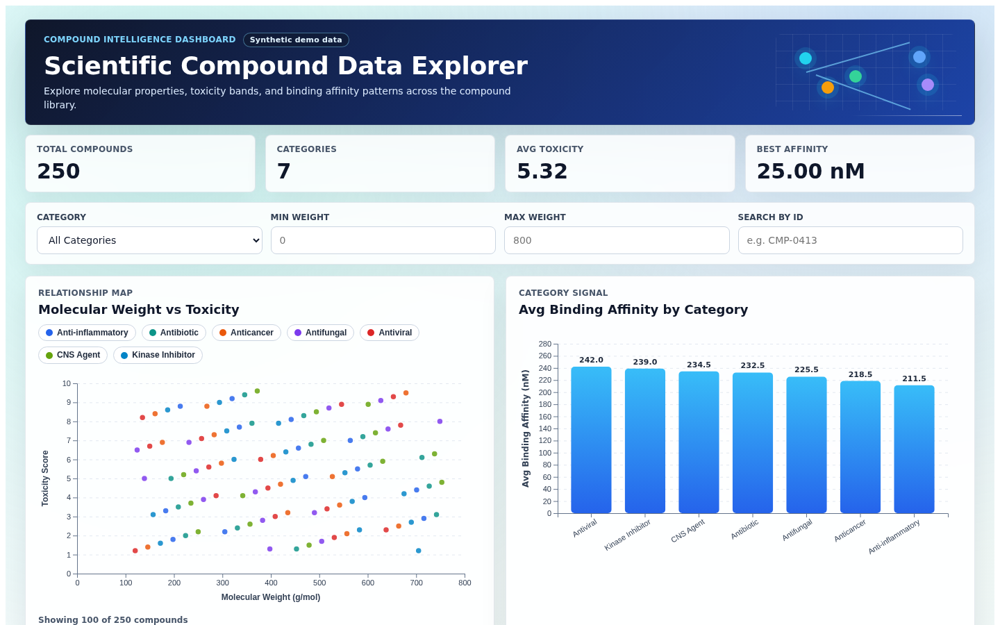
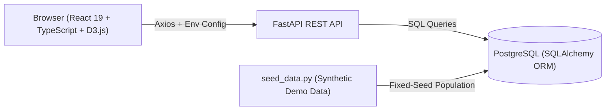

# Scientific Compound Data Explorer

Interactive full-stack dashboard for filtering, analyzing, and visualizing synthetic scientific compound libraries with React, TypeScript, D3.js, FastAPI, and PostgreSQL.



**Live Demo:** [https://scientific-dashboard-ui.vercel.app/](https://scientific-dashboard-ui.vercel.app/)  
**Live API:** [https://scientific-dashboard-api.vercel.app/](https://scientific-dashboard-api.vercel.app/)


## Overview

The Scientific Compound Data Explorer lets users filter compounds by category, molecular weight range, and ID, inspect summary KPIs, explore three responsive D3 visualizations, sort and paginate through compound records, and export filtered results to CSV.

> **Note:** The dataset is synthetic demo data generated with a fixed random seed (`seed_data.py`). It is not a real pharmaceutical or chemistry dataset.

## Architecture



## Features

- **Reactive KPI Summary**: Total compounds, active categories, average toxicity, and best binding affinity update dynamically with filters.
- **Interactive D3 Visualizations**:
  - **Molecular Weight vs Toxicity Scatter Plot**: Clickable category color legend, rich hover tooltips (ID, category, weight, toxicity, affinity), point selection, and `"Showing N of M compounds"` caption.
  - **Avg Binding Affinity Bar Chart**: Sorted descending with value labels, exact mean & compound count tooltips.
  - **Molecular Weight Distribution Histogram**: 100 g/mol buckets with compound count tooltips.
  - All charts resize via `ResizeObserver` and display clear empty states when no records match.
- **Sortable, Paginated Table**: Server/client-consistent sorting across all columns, 25 rows per page, ID search, category chips, `"Showing 1-25 of N"` indicator, and CSV export.
- **Resilient UX**: Loading skeletons, 3-second cold-start notice, friendly error banner with Retry, debounced & validated weight filters (`min <= max`), and responsive layout down to `390px`.

## Tech Stack

| Layer | Technologies |
| --- | --- |
| Frontend | React 19, TypeScript, Vite, Axios, CSS Modules |
| Visualization | D3.js v7 |
| Backend | FastAPI, SQLAlchemy, Pydantic, Uvicorn |
| Database | PostgreSQL |
| Testing | Vitest, React Testing Library, jsdom, Playwright |
| Component Docs | Storybook |
| CI | GitHub Actions |

## API Endpoints

| Method | Endpoint | Description |
| --- | --- | --- |
| `GET` | `/` | API health check |
| `GET` | `/compounds` | Paginated, filtered, sortable compound list |
| `GET` | `/compounds/stats` | Aggregate category and molecular weight distribution stats |
| `GET` | `/compounds/{compound_id}` | Single compound by numeric ID |
| `POST` | `/compounds` | Create a compound |
| `GET` | `/compounds/categories/list` | List distinct compound categories |

### `/compounds` Query Parameters

- `page` (default `1`), `page_size` (default `20`, max `100`)
- `category`, `min_weight`, `max_weight`, `min_toxicity`, `max_toxicity`, `search`
- `sort_by` (`id`, `name`, `category`, `molecular_weight`, `toxicity_score`, `binding_affinity`), `sort_order` (`asc`, `desc`)

## Running Locally

### 1. Backend (FastAPI + PostgreSQL)

```bash
cd backend
python3 -m venv .venv
source .venv/bin/activate
pip install -r requirements.txt
cp .env.example .env
# Edit .env with your PostgreSQL DATABASE_URL and CORS_ORIGINS
python seed_data.py
uvicorn main:app --reload --port 8000
```

API docs are available at `http://127.0.0.1:8000/docs`.

### 2. Frontend (React + Vite)

```bash
cd frontend
npm ci
cp .env.example .env
# Set VITE_API_URL=http://localhost:8000 (or your deployed API URL)
npm run dev
```

Open `http://localhost:5173`.

## Running Tests, Lint, and Storybook

```bash
cd frontend
npm run lint
npm test
npm run build
npm run storybook
```

## Limitations

- **Synthetic Data**: All compound records, formulas, molecular weights, solubilities, toxicity scores, and binding affinities are synthetically generated in `backend/seed_data.py` using a fixed random seed (`42`) for reproducible demonstration and UI testing.
- **Sampling**: The scatter plot displays up to 100 compounds per API query (`page_size=100`) and indicates the exact count in its caption.

## License

[MIT](LICENSE)
